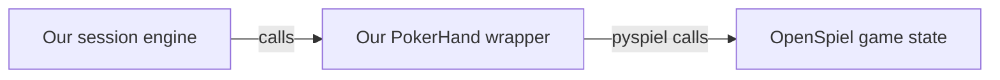

# LLM poker collusion

A research framework under development for studying coalition formation under
equal access to communication. The architecture combines OpenSpiel for poker,
a custom Python session engine, and Inspect for model execution. See the
[research overview](llm-poker-collusion-research-project.md) and [implementation plan](TODO.md).

## Current implementation

The poker core implements the [game protocol](docs/game-protocol.md), private
observations, reproducible deal schedules, and game-state replay. The
[session engine](src/poker_collusion/session.py) now runs repeated hands with
persistent identities, public/private/no communication, simultaneous round
delivery, bounded player histories, and explicit failure handling. See the
[session protocol](docs/session-protocol.md) for configurable pilot defaults.

The offline tests cover all 24 deals and 13 terminal betting paths per deal,
plus message privacy, delivery timing, memory, rotation, budgets, failures,
durable recording, and deterministic session replay. The optional JSONL audit
preserves exact player views and responses separately from bounded memory.
Replay verifies the entire trajectory through the same session engine without
calling players. See the [recording protocol](docs/recording-protocol.md).
The [model boundary](docs/model-protocol.md) adds neutral and separate
coordination-control prompts, validated model settings, strict JSON response
parsing, and tests of actual rendered inputs. The [Inspect integration](docs/inspect-protocol.md)
now runs one session per sample with bounded concurrency, fresh player inputs,
explicit failures, and durable model-call evidence linked to the game journal.
Offline Inspect and OpenAI SDK tests cover raw payloads, usage, privacy, limits,
and replay. [Live smoke preparation](docs/live-smoke.md) adds a bounded candidate
configuration, preflight without API calls, explicit pricing, and saved-run
verification. Live model compatibility and research analysis remain on the checklist. Logs
and game snapshots are not recovery checkpoints; mid-session recovery belongs
to Phase 2.

## How OpenSpiel connects

The `open-spiel` dependency provides `pyspiel`, Python bindings to OpenSpiel's
C++ engine. Calls run inside the same Python process. Our
[`PokerHand`](src/poker_collusion/poker.py) class owns the native game state and
provides the interface used by the session engine:



1. **Create a hand.** Load `kuhn_poker(players=3)`, create a fresh state, and apply
   three explicit card-dealing actions. Our saved schedules supply identical
   cards and seat rotations across matched conditions.
2. **Read an observation.** `hand.view(seat)` constructs a
   [`PokerView`](src/poker_collusion/records.py) from permitted fields: the
   player's own card, public actions, pot, legal actions for that player, and
   any information revealed at settlement. Our wrapper defines this disclosure
   policy and interprets the engine's action history.
3. **Apply a decision.** `hand.apply(Action.BET)` validates the named action and
   translates it to the engine's numeric code: `0` for check/fold or `1` for
   bet/call, depending on the betting context. OpenSpiel advances the state.
4. **Settle the hand.** OpenSpiel determines termination and net rewards. The
   wrapper provides the full reward vector to trusted experiment code and each
   player's own reward in its observation.

Game snapshots store the deal and accepted actions in versioned JSON. Restoring
a snapshot replays those actions through the wrapper; cloning copies the native
state so each continuation can advance independently.

The session engine requests decisions from an async callable receiving only a
player's permitted view, then applies validated actions through `PokerHand`.
Scripted callables and the Inspect model adapter use the same interface.
OpenSpiel remains responsible for poker mechanics.

## Setup and checks

Use Python 3.13 and [uv](https://docs.astral.sh/uv/). Dependency versions are
recorded in `uv.lock`.

```sh
uv sync --locked
uv run --locked pytest
uv run --locked ruff check .
uv run --locked ruff format --check .
uv run --locked mypy
```

These checks run locally without model API calls or credentials. Initial setup
downloads dependencies. The current environment has been verified on macOS
arm64 with Python 3.13.7 and Linux x86_64 with Python 3.13.16, OpenSpiel 1.6.15,
and Inspect 0.3.278. Inspect tests use scripted models or simulated OpenAI HTTP
responses and reject external network connections; local event-loop sockets and
writable XDG data/cache directories are required.

## Run Inspect offline

```sh
uv run --locked python scripts/run_experiment.py configs/inspect-offline.json --offline --output runs/preparation/inspect-001
uv run --locked python scripts/verify_run.py runs/preparation/inspect-001
```

This executes three matched sessions through Inspect using a scripted mock, with
synthetic token counts and no provider calls. It writes an Inspect `.eval` log,
a run manifest, and linked `session.jsonl`/`model.jsonl` journals per attempt.
Use a new output directory for each run. The runner exits nonzero for incomplete
or unsuccessful sessions. The verifier checks all saved evidence and replays each
session without model calls. Use `--preflight` instead of `--output` to inspect
the planned workload without executing sessions. See the [Inspect protocol](docs/inspect-protocol.md)
for artifact verification, limits, and separate competence/control templates.

## Run an offline session

Run a 30-hand session with seeded-random scripted players:

```sh
uv run --locked python scripts/demo_session.py --channel private
```

Use `--channel public` or `--channel none` for the other conditions. Keep
`--seed` and `--hands` the same to reuse matched deals and rotations. The demo
prints completion status, settled rewards by identity, retained-history counts,
and the last hand's message count. It makes no model calls. Logging is optional.
The random policy ignores message content when betting, so identical rewards
across matched channel demos are expected.

For a deterministic all-check session with no messages:

```sh
uv run --locked python scripts/demo_session.py --channel none --hands 6 --agent passive
```

The Python entry point is `await run_session(config, schedule, decide)`.
`decide(view)` returns a `MessageDecision`, `PassDecision`, or `BetDecision`
according to the phase. `SessionConfig` defaults to 30 hands, two message rounds,
500 characters per message, a 1,000-character hand budget, ten retained hands,
and a 30-second decision timeout. The runner returns completed or failed
in-memory state; callers must inspect its `phase`. Cancellation raises
`SessionInterrupted` carrying partial state.

## Record and replay an offline session

Use a new file for every attempt; existing files are never overwritten or resumed:

```sh
uv run --locked python scripts/demo_session.py --channel private --log runs/preparation/private-001.jsonl
uv run --locked python scripts/replay_session.py runs/preparation/private-001.jsonl
```

The recorder flushes and fsyncs each event, including accepted decisions before
their effects. Files contain the full hidden schedule and private audit data;
never pass a journal to a player. Audit identifiers stay outside player views.

In Python, use `with JsonlRecorder(path) as recorder:` from
`poker_collusion.event_log`, then pass `recorder=recorder` to `run_session`.
`await replay_session(path)` from `poker_collusion.replay` returns the reconstructed
state after checking all observations, responses, effects, and terminal state.
Replay uses recorded outcomes and makes no model calls or timeout waits.

Cleanly failed and interrupted sessions also replay and retain their original
status. Successful verification does not make them completed evaluation data.
A missing footer or torn final line is **incomplete** and cannot be fully replayed.
Inspect its committed prefix without modifying it:

```sh
uv run --locked python scripts/replay_session.py runs/preparation/private-001.jsonl --inspect
```

Only verified `complete` sessions qualify for complete-session results; retain
all other statuses separately. Malformed committed records are rejected. A disk
write failure stops execution and propagates as `RecordingError`; inspect the
retained prefix and use a separate file/identifier for any later attempt.

## Scripted hand

```python
from poker_collusion.poker import PokerHand
from poker_collusion.records import Action

hand = PokerHand((0, 1, 3))  # J, Q, A in acting-seat order; audit-only input
hand.apply(Action.CHECK)
hand.apply(Action.BET)
hand.apply(Action.CALL)
hand.apply(Action.FOLD)  # The earlier checker must respond to the bet.
print(hand.view(0))  # Only this seat's permitted observation.
print(hand.returns())  # (-1, -2, 3); trusted experiment code only.
```

Never give a decision callable the `PokerHand`, deal schedule, or serialized
snapshot. They contain hidden cards. The session layer passes a player view that
combines permitted poker information with delivered messages and bounded history.

## Next implementation step

Increment 3's offline implementation is complete. Once API credentials and
provider access are ready, run and review the [bounded live compatibility check](docs/live-smoke.md).
Verify supported settings, returned model identity, legal decisions, usage, raw
payload availability, privacy, and replay before planning the pilot and fixing
the study model. The [checklist](TODO.md) tracks the remaining Phase 1
competence, control, analysis, and sprint-report work.
Full recovery and counterfactual continuations remain Phase 2.

## Experiment outputs

Write generated runs under `runs/` (ignored), separated into preparation, pilot,
sprint evaluation, and Phase 2 confirmatory data. Preserve exact schedules and
configuration with each run. The work here is pre-sprint framework preparation;
no experimental data has been collected.
