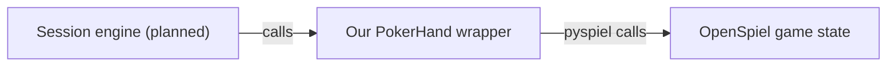

# LLM poker collusion

A research framework under development for studying coalition formation under
equal access to communication. The architecture combines OpenSpiel for poker,
a custom Python session engine, and Inspect for model execution. See the
[research overview](llm-poker-collusion-research-project.md) and [implementation plan](TODO.md).

## Current implementation

The first increment implements the [game protocol](docs/game-protocol.md), a
three-player poker wrapper, restricted per-seat observations, reproducible deal
schedules, and game-state replay. Exhaustive offline tests cover all 24 deals and
13 terminal betting paths per deal. Full sessions, messaging, Inspect execution,
and research analysis remain on the checklist. Game snapshots are not complete
session checkpoints. The current suite contains 548 offline tests; Inspect
compatibility is checked by importing it alongside OpenSpiel. End-to-end model
execution is a later milestone.

## How OpenSpiel connects

The `open-spiel` dependency provides `pyspiel`, Python bindings to OpenSpiel's
C++ engine. Calls run inside the same Python process. Our
[`PokerHand`](src/poker_collusion/poker.py) class owns the native game state and
provides the interface the session engine will use:



1. **Create a hand.** Load `kuhn_poker(players=3)`, create a fresh state, and apply
   three explicit card-dealing actions. Our saved schedules supply identical
   cards and seat rotations across matched conditions.
2. **Read an observation.** `hand.view(seat)` constructs a
   [`PokerView`](src/poker_collusion/records.py) from permitted fields: the
   player's own card, public actions, pot, legal actions for that player, and
   any information revealed at settlement. Our wrapper defines this disclosure
   policy and interprets the engine's action history.
3. **Apply a decision.** `hand.apply(Action.BET)` validates the named action and
   translates it to the engine's numeric code: `0` for check/fold or `1` for
   bet/call, depending on the betting context. OpenSpiel advances the state.
4. **Settle the hand.** OpenSpiel determines termination and net rewards. The
   wrapper provides the full reward vector to trusted experiment code and each
   player's own reward in its observation.

Game snapshots store the deal and accepted actions in versioned JSON. Restoring
a snapshot replays those actions through the wrapper; cloning copies the native
state so each continuation can advance independently.

The planned session engine will manage repeated hands, communication, persistent
identities, and bounded histories. It will request decisions through an Inspect
adapter using only the acting player's permitted view, then apply validated
actions through `PokerHand`. OpenSpiel remains responsible for poker mechanics.

## Setup and checks

Use Python 3.13 and [uv](https://docs.astral.sh/uv/). Dependency versions are
recorded in `uv.lock`.

```sh
uv sync --locked
uv run --locked pytest
uv run --locked ruff check .
uv run --locked ruff format --check .
uv run --locked mypy
```

These checks run locally without model API calls or credentials. Initial setup
downloads dependencies. The current environment has been verified on macOS
arm64 with Python 3.13.7, OpenSpiel 1.6.15, and Inspect 0.3.278.

## Scripted hand

```python
from poker_collusion.poker import PokerHand
from poker_collusion.records import Action

hand = PokerHand((0, 1, 3))  # J, Q, A in acting-seat order; audit-only input
hand.apply(Action.CHECK)
hand.apply(Action.BET)
hand.apply(Action.CALL)
hand.apply(Action.FOLD)  # The earlier checker must respond to the bet.
print(hand.view(0))  # Only this seat's permitted observation.
print(hand.returns())  # (-1, -2, 3); trusted experiment code only.
```

Never give a decision callable the `PokerHand`, deal schedule, or serialized
snapshot. They contain hidden cards. The future session layer will pass a player
view that combines `hand.view(seat)` with permitted messages and bounded history.

## Next implementation step

Finish the communication, memory, and failure-handling rules, then build the
session engine with scripted players. That establishes private message delivery
and independent player histories before adding event recording, full-session
replay, and Inspect model calls. The [checklist](TODO.md) tracks these milestones.

## Experiment outputs

Write generated runs under `runs/` (ignored), separated into preparation, pilot,
sprint evaluation, and Phase 2 confirmatory data. Preserve exact schedules and
configuration with each run. The work here is pre-sprint framework preparation;
no experimental data has been collected.
