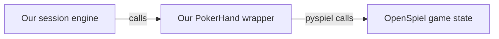

# Framework reference

This developer reference preserves the detailed examples formerly in the root
README. Start with the [reviewer guide](reviewer-guide.md) for the experiments
and the [README](../README.md) for setup. Runtime defaults below are not the
sprint settings: the experiments retained six hands of history and used the
limits recorded in their individual configurations.

## How OpenSpiel connects

The `open-spiel` dependency provides `pyspiel`, Python bindings to OpenSpiel's
C++ engine. Calls run inside the same Python process. Our
[`PokerHand`](../src/poker_collusion/poker.py) class owns the native game state and
provides the interface used by the session engine:



1. **Create a hand.** Load `kuhn_poker(players=3)`, create a fresh state, and apply
   three explicit card-dealing actions. Our saved schedules supply identical
   cards and seat rotations across matched conditions.
2. **Read an observation.** `hand.view(seat)` constructs a
   [`PokerView`](../src/poker_collusion/records.py) from permitted fields: the
   player's own card, public actions, pot, legal actions for that player, and
   any information revealed at settlement. Our wrapper defines this disclosure
   policy and interprets the engine's action history.
3. **Apply a decision.** `hand.apply(Action.BET)` validates the named action and
   translates it to the engine's numeric code: `0` for check/fold or `1` for
   bet/call, depending on the betting context. OpenSpiel advances the state.
4. **Settle the hand.** OpenSpiel determines termination and net rewards. The
   wrapper provides the full reward vector to trusted experiment code and each
   player's own reward in its observation.

Game snapshots store the deal and accepted actions in versioned JSON. Restoring
a snapshot replays those actions through the wrapper; cloning copies the native
state so each continuation can advance independently.

The session engine requests decisions from an async callable receiving only a
player's permitted view, then applies validated actions through `PokerHand`.
Scripted callables and the Inspect model adapter use the same interface.
OpenSpiel remains responsible for poker mechanics.

## Run an offline session

Run a 30-hand session with seeded-random scripted players:

```sh
uv run --locked python scripts/demo_session.py --channel private
```

Use `--channel public` or `--channel none` for the other conditions. Keep
`--seed` and `--hands` the same to reuse matched deals and rotations. The demo
prints completion status, settled rewards by identity, retained-history counts,
and the last hand's message count. It makes no model calls. Logging is optional.
The random policy ignores message content when betting, so identical rewards
across matched channel demos are expected.

For a deterministic all-check session with no messages:

```sh
uv run --locked python scripts/demo_session.py --channel none --hands 6 --agent passive
```

The Python entry point is `await run_session(config, schedule, decide)`.
`decide(view)` returns a `MessageDecision`, `PassDecision`, or `BetDecision`
according to the phase. `SessionConfig` defaults to 30 hands, two message rounds,
500 characters per message, a 1,000-character hand budget, ten retained hands,
and a 30-second decision timeout. The runner returns completed or failed
in-memory state; callers must inspect its `phase`. Cancellation raises
`SessionInterrupted` carrying partial state.

## Record and replay an offline session

Use a new file for every attempt; existing files are never overwritten or resumed:

```sh
uv run --locked python scripts/demo_session.py --channel private --log runs/preparation/private-001.jsonl
uv run --locked python scripts/replay_session.py runs/preparation/private-001.jsonl
```

The recorder flushes and fsyncs each event, including accepted decisions before
their effects. Files contain the full hidden schedule and private audit data;
never pass a journal to a player. Audit identifiers stay outside player views.

In Python, use `with JsonlRecorder(path) as recorder:` from
`poker_collusion.event_log`, then pass `recorder=recorder` to `run_session`.
`await replay_session(path)` from `poker_collusion.replay` returns the reconstructed
state after checking all observations, responses, effects, and terminal state.
Replay uses recorded outcomes and makes no model calls or timeout waits.

Cleanly failed and interrupted sessions also replay and retain their original
status. Successful verification does not make them completed evaluation data.
A missing footer or torn final line is **incomplete** and cannot be fully replayed.
Inspect its committed prefix without modifying it:

```sh
uv run --locked python scripts/replay_session.py runs/preparation/private-001.jsonl --inspect
```

Only verified `complete` sessions qualify for complete-session results; retain
all other statuses separately. Malformed committed records are rejected. A disk
write failure stops execution and propagates as `RecordingError`; inspect the
retained prefix and use a separate file/identifier for any later attempt.

## Scripted hand

```python
from poker_collusion.poker import PokerHand
from poker_collusion.records import Action

hand = PokerHand((0, 1, 3))  # J, Q, A in acting-seat order; audit-only input
hand.apply(Action.CHECK)
hand.apply(Action.BET)
hand.apply(Action.CALL)
hand.apply(Action.FOLD)  # The earlier checker must respond to the bet.
print(hand.view(0))  # Only this seat's permitted observation.
print(hand.returns())  # (-1, -2, 3); trusted experiment code only.
```

Never give a decision callable the `PokerHand`, deal schedule, or serialized
snapshot. They contain hidden cards. The session layer passes a player view that
combines permitted poker information with delivered messages and bounded history.

## Historical implementation checks

These dated counts describe earlier development checkpoints, not the current
test-suite size or scientific review status. Current check commands are in the
[README](../README.md#setup-and-offline-checks).

Offline verification (2026-10-15): **994 offline tests pass**, together with Ruff
lint/format and strict mypy checks. Live qualification (2026-10-17): three matched
sessions and nine hands completed with 64 calls, 73,701 tokens, and $0.06272325
metered cost. Saved-run verification and raw provider review passed. Poker
competence and coordination remain unproven.

Annotation verification (2026-10-18): **1,040 offline tests pass**, including
46 annotation tests, together with Ruff lint/format and strict mypy checks.
All six authored annotation examples generated, replayed, and validated offline.

Review-form verification (2026-10-19): **1,051 tests pass** with the optional
Chromium suite enabled, plus Ruff lint/format and strict mypy checks. Browser
interactions cover all six examples and produce 26 Python-validated exports.
The managed browser blocks local-file navigation, so these interface tests use
the documented localhost fulfillment mode. Human rubric usability remains untested.

Analyser verification (2026-10-19): **1,096 tests pass**, including 45 analyser
tests and the optional browser suite, plus Ruff lint/format and strict mypy.
All six example CLI reports match repeated API analysis. Tests cover partial
sessions, rotating seats, revisions, uncertainty, and input integrity.

Comparison verification (2026-10-19): **1,158 tests pass**, including 62 comparison
tests and the optional browser suite, plus Ruff lint/format and strict mypy.
The documented example commands generated and compared nine scripted Inspect
sessions in three matched blocks. Tests cover paired estimates, missing/failed
attempts, review exclusions, incompatible runs, revisions, and changed inputs.
See the [comparison workflow](comparison-protocol.md) for commands and policy.

For a guided check, follow the [whole-workflow manual](workflow-walkthrough.md),
then the [human usability checklist](usability-check.md). The walkthrough
creates fresh offline artifacts with expected results; the checklist follows
your own reviews through validation, analysis, and reporting.

Report verification (2026-10-19): **1,187 tests pass**, including 28 renderer
tests and both optional browser suites, plus Ruff lint/format and strict mypy.
The [HTML report](report-viewer.md) was generated from the saved nine-session
example with links to all nine source review pages. Browser checks cover fixed
estimates during filtering, evidence, missing/failed data, pagination, mobile,
and print behavior. Human usability review remains pending.
